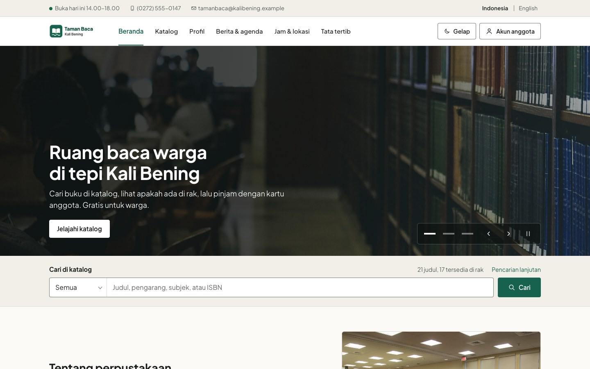
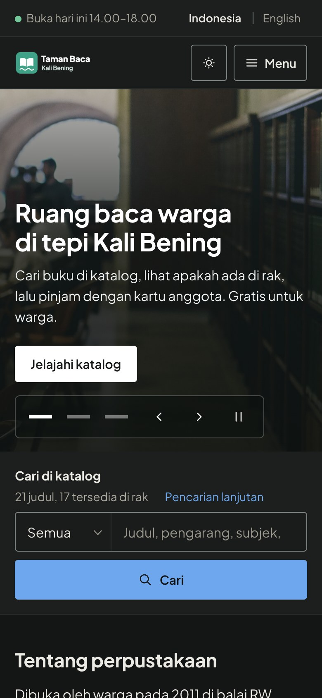
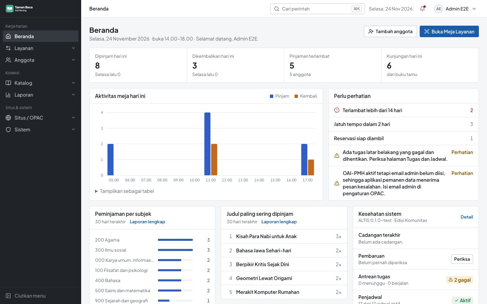
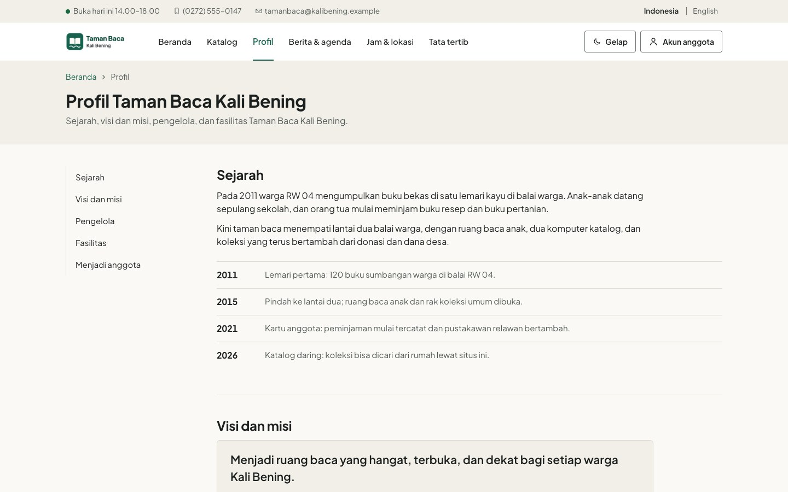
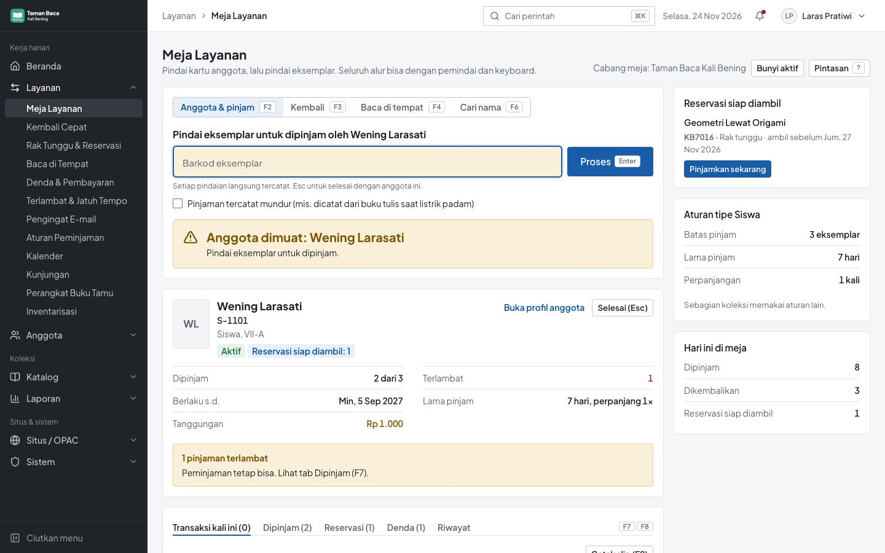
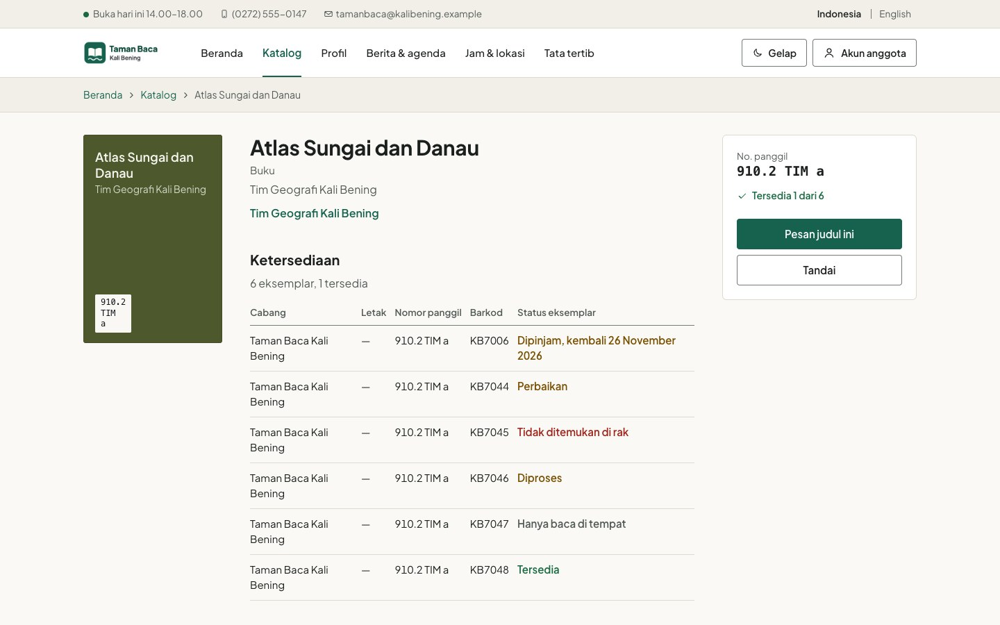
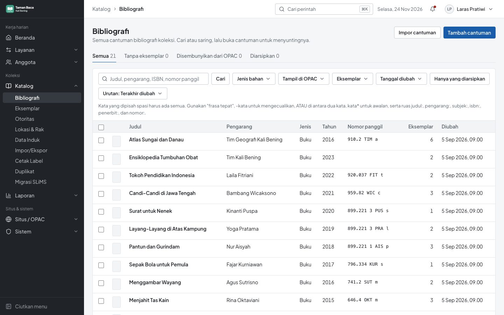
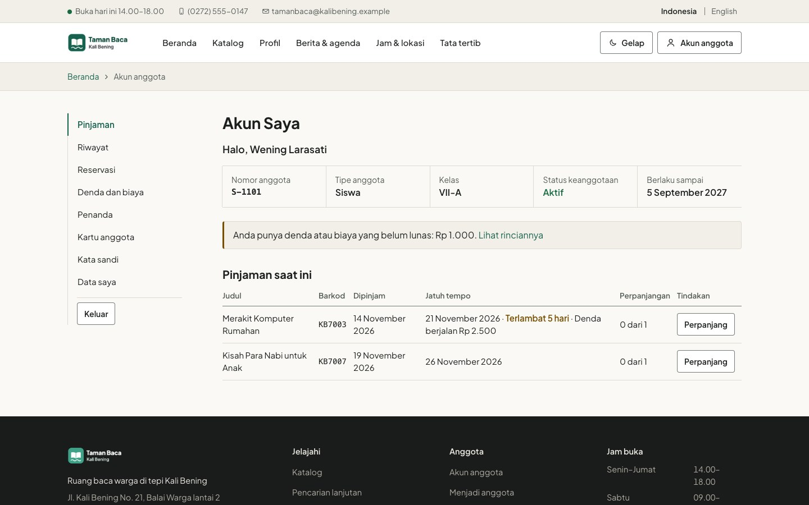
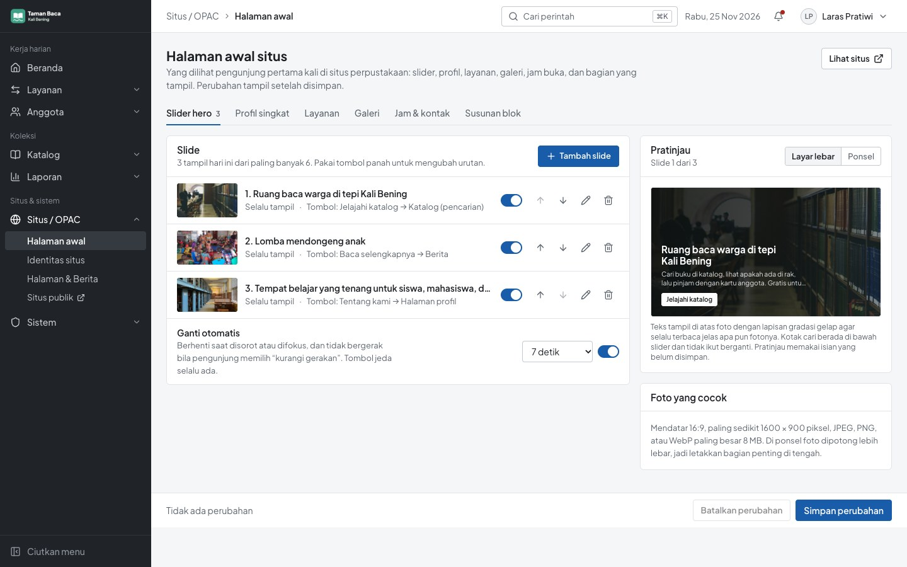

# ALTIS — Edisi Komunitas

**Arsya Library Tracking Information System**

ALTIS adalah sistem otomasi perpustakaan modern yang Anda pasang di server sendiri (*self-hosted*): alternatif SLiMS
untuk perpustakaan sekolah, kampus, dan umum. Edisi Komunitas bersifat sumber terbuka di bawah lisensi
[AGPL-3.0-only](LICENSE).

> **Pra-1.0.** Rilis pertama: [0.1.0](https://github.com/arjunaayasa/altis/releases). API dan skema masih dapat berubah
> antar versi pra-1.0.



[English](#english)

## Fitur (Edisi Komunitas)

- **Katalog:** bibliografi, eksemplar, data induk, kendali otoritas, lokasi/rak dengan peta rak, impor-ekspor
  MARC 21/MARCXML/CSV, deteksi duplikat, label dan barkod (PDF).
- **Anggota:** tipe anggota, foto, impor CSV, aksi massal dan naik kelas, kartu anggota (PDF), surat bebas pustaka,
  unduh dan anonimisasi data pribadi.
- **Layanan:** Meja Layanan yang bisa dijalankan penuh dengan pemindai dan keyboard, Kembali Cepat, baca di tempat,
  reservasi dan rak tunggu, denda dan pembayaran dengan kuitansi, daftar terlambat, pengingat e-mail, kalender hari
  tutup, aturan peminjaman per tipe anggota, tipe koleksi, dan jenis bahan.
- **Kunjungan:** buku tamu di perangkat sendiri (anggota dan tamu), check-in oleh petugas, kunjungan kelas.
- **Inventarisasi** (stock opname) per cabang dengan berita acara.
- **Laporan** koleksi, anggota, kunjungan, dan sirkulasi (pratinjau, cetak, ekspor CSV/XLSX/PDF), serta **ruang
  akreditasi**: perkiraan nilai, daftar periksa bukti, register, dan berkas siap cetak.
- **Situs profil perpustakaan dan OPAC:** beranda dengan slider yang dikelola dari admin, profil, galeri, berita dan
  agenda, halaman; identitas situs dengan logo sendiri; pencarian bawaan berfaset (FULLTEXT/GIN/FTS5); akun anggota
  (pinjaman, reservasi, penanda, denda); bahasa Indonesia dan Inggris, mode terang dan gelap (otomatis maupun lewat
  tombol di kepala situs), tetap berfungsi penuh tanpa JavaScript;
  feed, sitemap, JSON-LD.
- **Interoperabilitas:** OAI-PMH, salin katalog lewat SRU, pencarian ISBN.
- **Migrasi dari SLiMS:** dari dump SQL atau koneksi langsung ke database SLiMS: katalog, lampiran dan sampul, anggota,
  kunjungan, dan sirkulasi, dengan uji kering, rekonsiliasi, dan daftar periksa hari pindah.
- **Admin:** satu sidebar kiri, palet perintah, dasbor dengan kartu kesehatan sistem, terang dan gelap.
- **Fondasi:**
  - wizard pemasangan;
  - login dengan 2FA; pengguna, peran, dan cabang;
  - jejak audit berantai;
  - job dan penjadwal, notifikasi, unggahan;
  - backup dan restore (juga lintas mesin database);
  - mode pemeliharaan, Diagnostik;
  - pembaruan sekali klik yang aman: rilis ditandatangani Ed25519, pergantian versi atomik dengan backup dan
    rollback otomatis; atau unggah zip tanpa internet, atau image Docker baru.

## Tampilan

Semua tangkapan layar memakai data contoh perpustakaan fiktif "Taman Baca Kali Bening".

| Situs dan OPAC | Admin |
| --- | --- |
| <br>Beranda di ponsel, mode gelap | <br>Dasbor admin |
| <br>Profil perpustakaan | <br>Meja Layanan: pinjam dan kembali dengan pemindai |
| <br>Halaman judul dan ketersediaan eksemplar | <br>Katalog: daftar bibliografi |
| <br>Akun anggota | <br>Slider beranda dikelola dari admin |

## Panduan

- **Pustakawan dan petugas:** [docs/panduan/](docs/panduan/README.md), yaitu langkah pertama setelah instalasi, lalu
  katalog, anggota, layanan, kunjungan, inventarisasi, laporan dan akreditasi, situs/OPAC, sistem, dan migrasi dari
  SLiMS.
- **Pemasangan dan operasional server:** [docs/install/](docs/install/) dan [docs/ops/operations.md](docs/ops/operations.md).

## Persyaratan

- Node.js 22.16 atau lebih baru.
- Database: SQLite (bawaan), MySQL 8.0+, MariaDB 10.6+, atau PostgreSQL 15+.
- Hosting: cPanel/CloudLinux (Passenger), aaPanel, Docker, PM2, atau satu PC.

## Mulai cepat

Unduh zip rilis dari halaman [Releases](https://github.com/arjunaayasa/altis/releases). Zip resmi ditandatangani
kunci rilis Edisi Komunitas (sidik jari di [tools/keys/community/FINGERPRINTS.md](tools/keys/community/FINGERPRINTS.md)).
Build `-test` dari kode sumber hanya untuk evaluasi, jangan pernah untuk data sungguhan. Fork yang menerbitkan rilisnya
sendiri memakai kuncinya sendiri ([docs/ops/release-signing.md](docs/ops/release-signing.md)).

### Docker

Pakai image resmi [`arjunaayasa/altis`](https://hub.docker.com/r/arjunaayasa/altis) di Docker Hub:

1. Salin berkas folder [`docker/`](docker/) ke satu folder di server, lalu jalankan `./altis-init` (menulis `.env`
   dan menampilkan kode pemasangan).
2. Di `.env`, hapus tanda `#` di depan `ALTIS_IMAGE` dan isi versi rilis terbaru (misalnya `arjunaayasa/altis:0.1.0`).
3. `docker compose pull && docker compose up -d`, lalu pasang proxy TLS di depannya.
4. Buka `https://<domain>/install`.

Image juga tetap bisa dibangun sendiri dari zip rilis. Panduan lengkap: [docs/install/docker.md](docs/install/docker.md).

### cPanel

1. Buat database MySQL/MariaDB kosong lewat **MySQL® Database Wizard**.
2. Ekstrak zip rilis ke `~/altis/app` (di luar `public_html`).
3. Daftarkan aplikasi di **Application Manager** (atau **Setup Node.js App** di CloudLinux).
4. Buka `https://<domain>/install` dan pasang baris cron dari wizard.

Panduan lengkap: [docs/install/cpanel.md](docs/install/cpanel.md) dan
[docs/install/cloudlinux.md](docs/install/cloudlinux.md).

### Satu PC

1. Pasang Node.js 22.16+ dari [nodejs.org](https://nodejs.org).
2. Ekstrak zip rilis, lalu dari foldernya jalankan `node app.js`.
3. Buka `http://127.0.0.1:3000/install` dan masukkan kode pemasangan dari terminal.

Panduan lengkap: [docs/install/node-lokal.md](docs/install/node-lokal.md). Panduan lain: [aaPanel](docs/install/aapanel.md),
[PM2](docs/install/pm2.md), dan [aturan operasional](docs/ops/operations.md).

## Dari kode sumber

Butuh Node.js 22.16+ dan pnpm 10 (`corepack enable`; Node.js 25 ke atas tidak lagi membawa Corepack, jadi jalankan
dulu `npm install -g corepack`, atau langsung `npm install -g pnpm@10.15.0`), dari *clone* git repositori ini:

```sh
pnpm install
pnpm check      # tsc + eslint
pnpm test       # uji unit dan admin
```

Build evaluasi (zip di `dist/altis-0.1.0-test.zip`):

```sh
pnpm release --profile test --version 0.1.0-test
```

> **Peringatan: build `-test` mempercayai kunci pengembangan publik (`tools/keys/dev`).** Siapa pun dapat
> menandatangani pembaruan untuk build itu. Jangan pernah memakainya di produksi atau untuk data sungguhan.

Build produksi membutuhkan kunci Anda sendiri: lihat [docs/ops/release-signing.md](docs/ops/release-signing.md).

## Edisi komersial

Edisi dengan modul dan layanan tambahan akan menyusul; Edisi Komunitas tetap AGPL dan tanpa batas waktu.

## Kontribusi, keamanan, lisensi

- **Kontribusi:** baca [CONTRIBUTING.md](CONTRIBUTING.md) (termasuk pemberian lisensi kontributor yang wajib).
- **Keamanan:** laporkan celah secara privat, lihat [SECURITY.md](SECURITY.md).
- **Lisensi:** [AGPL-3.0-only](LICENSE); lihat juga [NOTICE](NOTICE). Bila Anda menjalankan versi yang diubah untuk
  pengguna lewat jaringan, AGPL-3.0 pasal 13 mewajibkan Anda menawarkan kode sumber versi itu kepada mereka. Tautan
  "Kode sumber" di footer OPAC dan di halaman Tentang menunjuk ke repositori ini: sebuah fork mengganti
  `COMMUNITY_SOURCE_URL` di `packages/shared/src/edition.ts` (dan label `org.opencontainers.image.source` di
  `docker/Dockerfile`) dengan repositorinya sendiri.

---

## English

ALTIS (Arsya Library Tracking Information System), Community Edition, is a modern self-hosted library automation
system: an alternative to SLiMS for school, academic and public libraries, under [AGPL-3.0-only](LICENSE).

> **Pre-1.0.** First release: [0.1.0](https://github.com/arjunaayasa/altis/releases). The API and schema may still
> change between pre-1.0 versions.

### Screenshots

All screenshots use the sample data of a fictional library, "Taman Baca Kali Bening".


| Library site and OPAC | Admin |
| --- | --- |
| <br>Home page on a phone, dark mode | <br>Admin dashboard |
| <br>Library profile | <br>Service desk: loans and returns with a scanner |
| <br>Title page with item availability | <br>Catalogue: bibliographic records |
| <br>Member account | <br>Home page slider managed from the admin |

**Features:** cataloguing (bibliographic records, items, master data, authority control, locations and shelves with
shelf maps, MARC 21/MARCXML/CSV import and export, duplicate detection, labels and barcodes as PDF); members (types,
photos, CSV import, bulk actions, member cards, clearance letters, personal data export and anonymisation); services
(a service desk that runs fully from a scanner and the keyboard, quick return, in-library use, holds and a hold shelf,
fines and payments with receipts, overdue lists, e-mail reminders, a closing-day calendar, loan rules per member
type, collection type and material type); visits (a guestbook on a device of your own, staff check-in, class visits);
stocktaking per branch; reports on the collection, members, visits and circulation (preview, print, CSV/XLSX/PDF
export) and an accreditation workspace (estimated score, evidence checklists, registers, print-ready files); a
library profile site and OPAC (a home page with a slider managed in the admin, profile, gallery, news and events,
pages, a site identity with your own logo, built-in faceted search on FULLTEXT/GIN/FTS5, member accounts, Indonesian
and English, light and dark (automatic or via the header toggle), working without JavaScript, feeds, sitemap and JSON-LD); OAI-PMH, SRU copy cataloguing
and ISBN lookup; **migration from SLiMS** (SQL dump or direct connection: catalogue, attachments and covers, members,
visits and circulation, with a dry run, reconciliation and a cutover checklist); an admin with one left sidebar and a
command palette; and the foundation: install wizard, 2FA login, users, roles and branches, a chained audit trail,
jobs and scheduler, notifications, uploads, backup and restore (across database engines), maintenance mode,
diagnostics, a dashboard, and safe one-click updates (Ed25519-signed releases, atomic switch with automatic backup
and rollback, offline zip upload or a new Docker image).

**Guides:** the librarian guide is in Indonesian, in [docs/panduan/](docs/panduan/README.md).

**Requirements:** Node.js 22.16+; SQLite (built in), MySQL 8.0+, MariaDB 10.6+ or PostgreSQL 15+; cPanel/CloudLinux
(Passenger), aaPanel, Docker, PM2 or a single PC.

**Install:** download the release zip from the [Releases](https://github.com/arjunaayasa/altis/releases) page. Official
zips are signed with the Community Edition release keys (fingerprints in
[tools/keys/community/FINGERPRINTS.md](tools/keys/community/FINGERPRINTS.md)). A `-test` build from source is for
evaluation only, never for real data; a fork that publishes its own releases uses its own keys
([docs/ops/release-signing.md](docs/ops/release-signing.md)). With Docker, use the official image
[`arjunaayasa/altis`](https://hub.docker.com/r/arjunaayasa/altis) on Docker Hub: copy `docker/` and run `./altis-init`,
in `.env` remove the `#` before `ALTIS_IMAGE` and set the latest release (such as `arjunaayasa/altis:0.1.0`), run `docker compose pull && docker compose up -d` behind a TLS
proxy and open `https://<domain>/install` (building the image from the release zip is still possible). The install
guides are in Indonesian:
[Docker](docs/install/docker.md), [cPanel](docs/install/cpanel.md), [CloudLinux](docs/install/cloudlinux.md),
[aaPanel](docs/install/aapanel.md), [PM2](docs/install/pm2.md) and [a single PC](docs/install/node-lokal.md).

**From source** (Node.js 22.16+ and pnpm 10 through `corepack enable`; Node.js 25 and later no longer ship Corepack,
so run `npm install -g corepack` first, or `npm install -g pnpm@10.15.0`): `pnpm install`, `pnpm check`, `pnpm test`;
an evaluation build with `pnpm release --profile test --version 0.1.0-test`. **Test builds trust the public
development keys of `tools/keys/dev`: never use them in production.** A production build needs your own keys
([docs/ops/release-signing.md](docs/ops/release-signing.md)).

**Commercial edition:** an edition with additional modules and services will follow; the Community Edition stays
AGPL and has no time limit.

**Contributing** ([CONTRIBUTING.md](CONTRIBUTING.md), a contributor licence grant is required), **security**
([SECURITY.md](SECURITY.md)) and **licence** ([AGPL-3.0-only](LICENSE), [NOTICE](NOTICE)). The "source code" link in
the OPAC footer and on the Tentang page points at this repository: a fork that runs a modified version sets
`COMMUNITY_SOURCE_URL` in `packages/shared/src/edition.ts` (and the `org.opencontainers.image.source` label in
`docker/Dockerfile`) to its own repository, as AGPL-3.0 section 13 requires.
