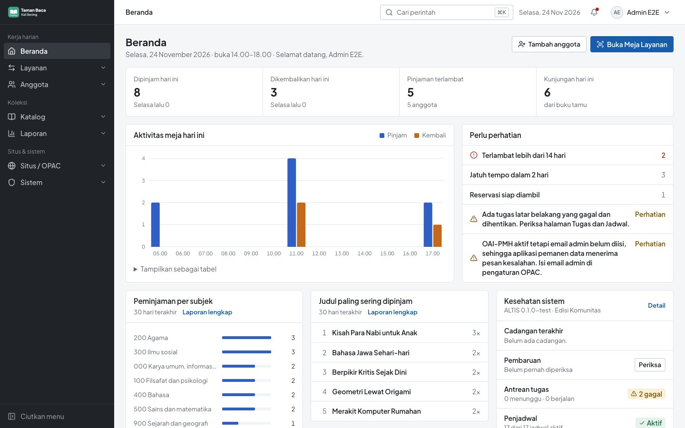

# Panduan pustakawan ALTIS

Panduan ini untuk pustakawan dan petugas yang memakai ALTIS sehari-hari. Isinya mengikuti menu di sidebar kiri
halaman admin (`/admin`). Untuk pemasangan di server, lihat [panduan instalasi](../install/).

## Daftar isi

| Halaman | Isi |
| --- | --- |
| [Katalog](katalog.md) | Cantuman, eksemplar, label, impor dan ekspor |
| [Anggota](anggota.md) | Tipe anggota, tambah anggota, impor CSV, kartu, surat bebas pustaka |
| [Layanan](layanan.md) | Meja Layanan, Kembali Cepat, reservasi, denda, terlambat dan pengingat, kalender, aturan |
| [Kunjungan](kunjungan.md) | Buku tamu dan catatan kunjungan |
| [Inventarisasi](inventarisasi.md) | Stock opname per cabang |
| [Laporan dan akreditasi](laporan-akreditasi.md) | Laporan, ekspor, ruang akreditasi |
| [Situs / OPAC](situs-opac.md) | Identitas situs dan logo, slider, profil, galeri, berita dan agenda, halaman |
| [Sistem](sistem.md) | Pengguna dan peran, cabang, cadangan, pembaruan, diagnostik |
| [Migrasi dari SLiMS](migrasi-slims.md) | Urutan pindah dari SLiMS sampai "Mulai melayani" |

## Mulai di sini (setelah instalasi)

Kerjakan berurutan. Setiap langkah cukup sekali, kecuali bila data perpustakaan berubah.

1. **Masuk** di `/admin` dengan akun yang dibuat saat pemasangan. Buka **Profil saya** (menu pengguna di kanan atas)
   dan nyalakan verifikasi dua langkah (2FA) untuk akun pengelola.
2. **Profil perpustakaan:** Sistem → Pengaturan → Profil perpustakaan. Isi nama dan alamat; nama ini tampil di
   admin, di situs, dan di e-mail.
3. **Identitas situs:** Situs / OPAC → Identitas situs. Unggah logo (PNG) dan ikon. Lihat [Situs / OPAC](situs-opac.md).
4. **Pengguna:** Sistem → Pengguna. Buat akun untuk setiap petugas, masing-masing dengan perannya. Jangan berbagi
   satu akun. Lihat [Sistem](sistem.md).
5. **Data induk katalog:** Katalog → Data Induk (jenis bahan, tipe koleksi) dan Katalog → Lokasi & Rak.
6. **Tipe anggota dan aturan pinjam:** Anggota → Tipe Anggota, lalu Layanan → Aturan Peminjaman. Tanpa aturan yang
   cocok, Meja Layanan menolak peminjaman.
7. **Kalender:** Layanan → Kalender. Catat hari libur supaya jatuh tempo tidak jatuh pada hari tutup.
8. **Isi koleksi:** ketik cantuman baru, impor berkas MARC/CSV, atau [migrasi dari SLiMS](migrasi-slims.md).
9. **Isi anggota:** tambah satu per satu atau impor CSV. Cetak kartu bila perlu.
10. **Cadangan:** Sistem → Cadangan. Buat satu cadangan, siapkan unduhannya, dan simpan di luar server.
11. **Coba satu putaran:** pinjamkan satu buku di Meja Layanan, kembalikan, lalu lihat hasilnya di Laporan.

## Hal yang berlaku di semua layar

- **Sidebar kiri** memuat semua menu, dikelompokkan menjadi Kerja harian, Koleksi, serta Situs & sistem. Menu yang
  tidak tampil berarti akun Anda tidak memegang izinnya.
- **Palet perintah:** tekan `Ctrl+K` (Mac: `⌘K`) untuk mencari halaman atau perintah dengan mengetik.
- **Pemindai barkod** bekerja seperti keyboard. Di layar yang mendukung pindai (Meja Layanan, Eksemplar, Cetak Label,
  Inventarisasi), Anda tidak perlu mengeklik kotak pindai lebih dulu.
- **Arsip, bukan hapus:** sebagian besar data diarsipkan, tidak dihapus. Data arsip tidak tampil di daftar biasa dan
  tidak bisa dipakai untuk transaksi baru.
- **Cabang:** Meja Layanan, kunjungan, dan inventarisasi selalu berjalan untuk satu cabang. Bila Anda bertugas di
  lebih dari satu cabang, pilih cabangnya di layar itu ("Cabang meja").
- **Bahasa dan tampilan:** bahasa (Indonesia atau Inggris) dan mode terang/gelap dipilih dari menu pengguna.
- **Konfirmasi kata sandi:** beberapa tindakan penting meminta kata sandi Anda sekali lagi. Itu wajar.
