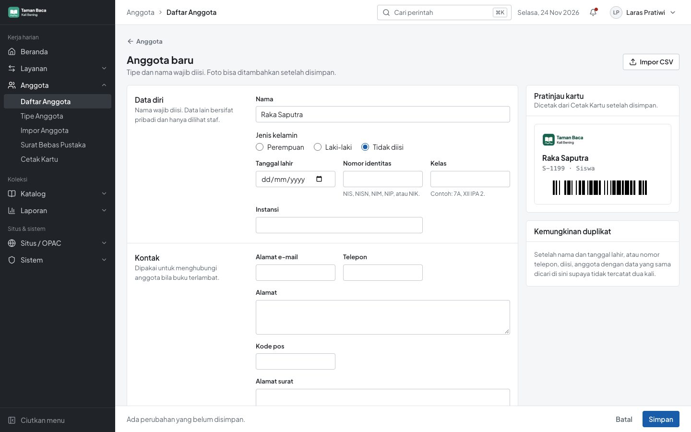
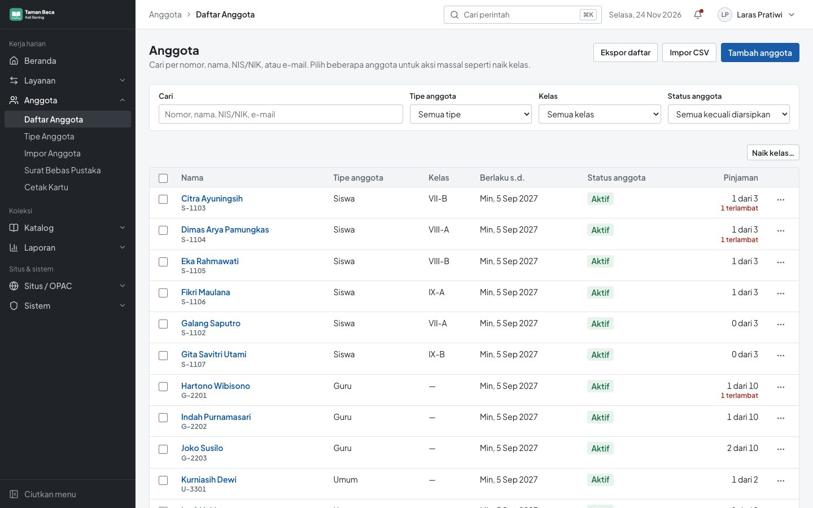

# Anggota

Menu **Anggota** di sidebar.

[Kembali ke daftar isi](README.md)

## Tipe anggota

**Anggota → Tipe Anggota.** Buat paling sedikit satu tipe sebelum menambah anggota, misalnya Siswa dan Guru.

- Tipe menentukan **batas jumlah pinjaman** dan **masa keanggotaan**.
- Lama pinjam, jumlah perpanjangan, dan denda **tidak** diatur di sini, tetapi di Layanan → Aturan Peminjaman.
- Mengubah tipe tidak menghitung ulang tanggal berlaku anggota yang sudah ada. Masa baru berlaku saat keanggotaan
  diperpanjang.
- Tipe yang masih dipakai anggota aktif tidak bisa diarsipkan. Pindahkan dulu anggotanya lewat aksi massal.

## Menambah anggota

**Anggota → Daftar Anggota → Tambah anggota.**

1. Isi **Data diri** (nama wajib), **Kontak**, lalu **Keanggotaan** (tipe wajib).
2. Nomor anggota: huruf besar/kecil dan spasi tidak membedakan, jadi `b 001` sama dengan `B001`.
3. Tanggal bergabung dan tanggal berakhir boleh dikosongkan: bergabung hari ini, berakhir menurut tipe.
4. Kotak **Kemungkinan duplikat** mencari anggota dengan nama dan tanggal lahir yang sama, atau nomor telepon yang
   sama. Kotak ini hanya mengingatkan; anggota tetap bisa disimpan bila memang orang lain.
5. Simpan. **Foto** ditambahkan setelah disimpan, dari berkas atau kamera, lalu dipotong 3:4.

Di halaman seorang anggota Anda juga bisa:

- **Perpanjang masa** keanggotaan;
- **Tangguhkan** (pinjam dan perpanjang diblokir, pengembalian tetap bisa) dan **aktifkan kembali**;
- **Arsipkan** (ditolak selama masih ada pinjaman terbuka);
- mengatur **kata sandi OPAC** supaya anggota bisa masuk ke Akun Anggota di situs dengan nomor anggotanya;
- **unduh data** anggota itu atau **anonimkan** secara permanen (hak anggota atas data pribadinya).

Catatan pada anggota hanya terlihat petugas dan ikut tampil di Meja Layanan.

## Aksi massal dan naik kelas

Di Daftar Anggota, centang beberapa anggota untuk aksi massal: perpanjang masa, ubah tipe/kelas/cabang, tangguhkan,
aktifkan kembali, arsipkan, pulihkan, dan **naik kelas**. Untuk naik kelas, tulis satu pasangan per baris, misalnya
`VII-A => VIII-A`. Kosongkan kelas tujuan untuk siswa yang lulus.

## Impor CSV

**Anggota → Impor Anggota**, misalnya untuk data siswa dari tata usaha.

1. Siapkan berkas CSV dengan baris kepala. Kolom wajib: `member_no`, `name`, `member_type` (kode tipe anggota). CSV dari
   Excel bisa langsung dipakai; pemisah koma atau titik koma; paling banyak 5.000 baris per berkas.
2. Pilih berkas dan periksa pemetaan kolom.
3. Jalankan **uji kering**. Tidak ada data yang ditulis; Anda mendapat laporan baris yang ditolak beserta alasannya.
4. Perbaiki berkas bila perlu, lalu jalankan impor.

Tipe anggota tidak pernah dibuat otomatis: buat dulu tipenya. Pada mode perbarui, sel kosong tidak menghapus isian
yang sudah ada.

## Kartu anggota

**Anggota → Cetak Kartu.**

1. Atur **Tampilan kartu** sekali: judul, isian di depan kartu, foto, jenis barkod, kode QR, warna pita, sisi belakang
   dengan tata tertib, dan penanda tangan. Kartu memakai logo dari Identitas situs.
2. Masukkan anggota ke antrean: pindai atau ketik nomornya, atau pilih dari Daftar Anggota.
3. Buat PDF. Satu berkas memuat paling banyak 200 kartu; antrean yang lebih panjang dipecah otomatis. Posisi mulai
   (1 sampai 10) berguna untuk memakai sisa lembar kartu yang sudah terpakai sebagian.

## Surat bebas pustaka

**Anggota → Surat Bebas Pustaka**, untuk anggota yang lulus atau pindah.

- Pilih anggota, lalu periksa. Anggota yang masih punya pinjaman, tanggungan biaya, atau reservasi di rak tunggu tidak
  mendapat surat; namanya tercantum di halaman terakhir PDF supaya bisa ditindaklanjuti.
- Surat bernomor urut. Awalan nomor dan penanda tangan diatur di Sistem → Pengaturan → Sirkulasi.
- Surat yang keliru bisa dibatalkan; nomornya tidak dipakai lagi.
