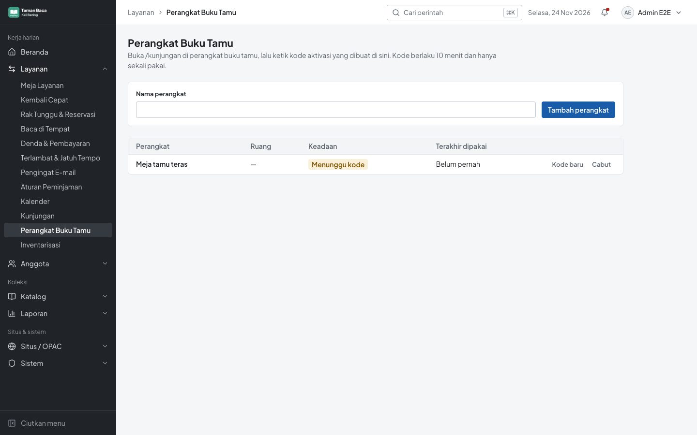
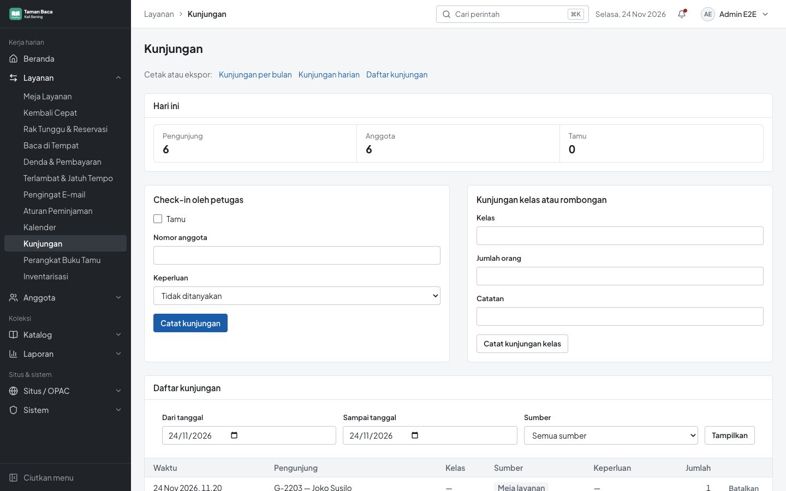

# Kunjungan

Kunjungan dicatat lewat **buku tamu**: sebuah komputer atau tablet di pintu masuk, atau oleh petugas.

[Kembali ke daftar isi](README.md)

## Menyiapkan perangkat buku tamu

1. Di admin, buka **Layanan → Perangkat Buku Tamu**, tambah perangkat (misalnya "Pintu depan"), dan buat **kode
   aktivasi**. Kode berlaku 10 menit, hanya sekali pakai, dan tidak ditampilkan lagi.
2. Di perangkat itu, buka alamat situs perpustakaan diikuti `/kunjungan`, lalu ketik kodenya.
3. Perangkat sekarang menampilkan halaman buku tamu dan bisa ditinggal menyala. Sambungkan pemindai barkod bila ada.

Bila perangkat hilang atau diganti, **cabut** perangkatnya di menu yang sama. Perangkat yang dicabut harus diaktifkan
ulang dengan kode baru.

## Cara pengunjung mengisi

- **Anggota:** memindai kartu atau mengetik nomor anggota. Layar menyapa dengan namanya.
- **Tamu:** memilih "Saya tamu", lalu mengisi nama, instansi atau asal, dan keperluan.
- Anggota yang masa keanggotaannya habis tetap dicatat dan diminta memperpanjang di meja layanan.

## Dicatat oleh petugas

**Layanan → Kunjungan:**

- **Check-in oleh petugas** untuk anggota atau tamu yang tidak mengisi sendiri;
- **Kunjungan kelas atau rombongan:** dicatat sekaligus dengan nama kelas dan jumlah orangnya;
- **Daftar kunjungan** menurut rentang tanggal dan sumbernya.

## Pengaturan

**Sistem → Pengaturan → Kunjungan:**

- **Kunjungan berulang:** check-in anggota yang sama di cabang yang sama dalam rentang waktu tertentu disambut tetapi
  tidak dihitung lagi. Isi 0 untuk mematikan aturan ini.
- Hitung aksi pertama anggota di Meja Layanan hari itu sebagai kunjungan (untuk perpustakaan tanpa perangkat buku tamu).
- Hitung masuk ke akun OPAC sebagai kunjungan daring.

**Sistem → Pengaturan → Privasi** mengatur berapa lama riwayat kunjungan dan pinjaman tetap tertaut ke orangnya.
Setelah masa itu, hitungan per bulan, tipe, dan kelas tetap ada, tetapi tanpa nama.

Angka kunjungan tampil di Beranda admin dan di laporan Kunjungan per bulan, Kunjungan harian, dan Daftar kunjungan.
