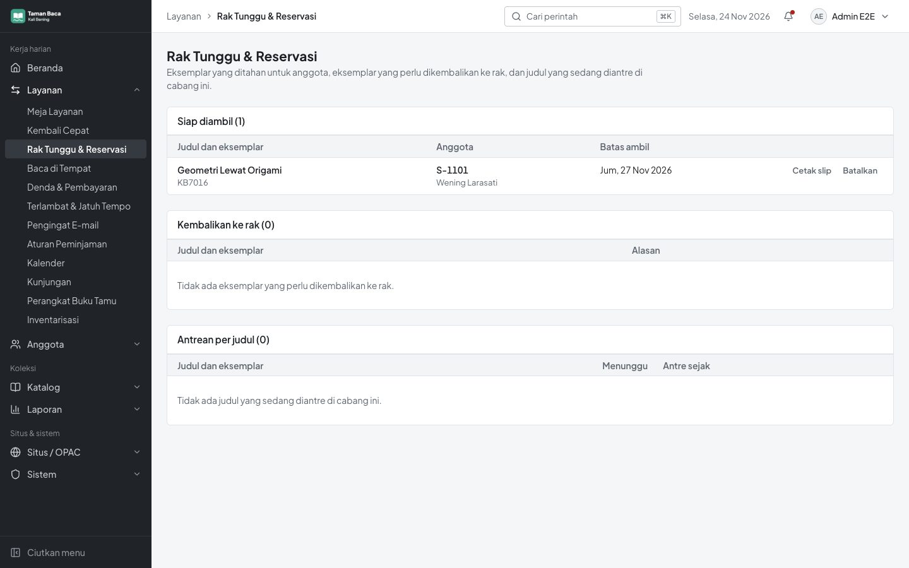

# Layanan

Menu **Layanan** di sidebar: semua yang terjadi di meja peminjaman.

[Kembali ke daftar isi](README.md)

## Meja Layanan

**Layanan → Meja Layanan.** Seluruh alur bisa dijalankan dengan pemindai dan keyboard, tanpa mouse.

Meminjamkan:

1. Pindai kartu anggota, atau ketik nomornya lalu Enter. Tidak bawa kartu? Tekan `F6` dan ketik namanya.
2. Panel anggota tampil: tipe, masa berlaku, jumlah pinjaman, tanggungan, dan peringatan bila ada (misalnya pinjaman
   terlambat, keanggotaan kedaluwarsa, atau ditangguhkan).
3. Pindai eksemplar satu per satu. Setiap pindaian langsung tercatat, dan jatuh temponya tampil.
4. Tekan `Esc` bila selesai dengan anggota itu. `F9` mencetak slip transaksi.

Mengembalikan: pindai saja eksemplarnya saat anggota itu sedang dimuat, atau tekan `F3` untuk menerima pengembalian
tanpa kartu. Pengembalian yang terlambat ditandai beserta jumlah harinya dan dendanya.

Pintasan (tekan `?` di Meja Layanan untuk daftar lengkap):

| Tombol | Fungsi |
| --- | --- |
| `F2` | Mode anggota dan pinjam |
| `F3` | Mode kembali |
| `F4` | Mode Baca di Tempat |
| `F6` | Cari anggota per nama |
| `F7` | Pindah tab panel anggota (Dipinjam, Reservasi, dan seterusnya) |
| `Esc` | Batal, lalu selesai dengan anggota |
| Panah, lalu `K` / `P` | Pilih baris pinjaman, lalu kembalikan / perpanjang (`Shift+P`: perpanjang semua) |
| `B` | Terima pembayaran untuk baris terpilih (`Shift+B`: bayar semua) |
| `H` | Catat eksemplar terpilih sebagai hilang |
| `Ctrl+Z` | Batalkan pinjaman terakhir (dalam batas waktu pembatalan) |
| `F9` | Cetak slip transaksi |

Kartu di sisi kanan menampilkan **Reservasi siap diambil** milik anggota itu (dengan tombol "Pinjamkan sekarang"),
**aturan tipe** anggotanya (batas, lama pinjam, perpanjangan), dan **Hari ini di meja**.

Bila Meja Layanan menolak:

- **Anggota kedaluwarsa:** perpanjang masa keanggotaannya, lalu pindai lagi.
- **Batas pinjaman penuh:** kembalikan salah satu pinjaman dulu.
- **Tidak ada aturan yang cocok / tipe koleksi tidak dipinjamkan:** periksa Aturan Peminjaman dan tipe koleksinya.
- **"Ini ISBN, bukan barkod eksemplar":** pindai label barkod perpustakaan, bukan barkod penerbit.
- Petugas yang memegang izin paksa bisa meneruskan pinjaman yang ditolak dengan menulis alasannya. Izin yang sama
  dipakai untuk **pinjaman tercatat mundur** (paling lama 30 hari), misalnya yang dicatat di buku tulis saat listrik padam.

**Eksemplar hilang:** pilih baris pinjamannya, tekan `H`. Pinjaman ditutup, denda sampai hari itu dan biaya penggantian
dibukukan, dan status eksemplar menjadi hilang. Bila bukunya ditemukan, pindai saja: ALTIS menawarkan menerimanya
kembali.

## Kembali Cepat dan Baca di Tempat

- **Layanan → Kembali Cepat:** meja khusus pengembalian, cocok untuk kotak pengembalian. Pindai eksemplar satu per satu.
- **Layanan → Baca di Tempat:** pindai buku yang selesai dibaca di ruang baca sebelum dikembalikan ke rak. Setiap pindaian
  dihitung satu kali baca; tidak ada data pembaca yang dicatat. Angkanya masuk laporan.

## Reservasi

- **Membuat:** dari panel anggota di Meja Layanan (tambah reservasi, cari judul, Pesan), atau oleh anggota sendiri dari
  akunnya di OPAC bila diizinkan.
- **Layanan → Rak Tunggu & Reservasi** menampilkan tiga hal: eksemplar yang sedang ditahan untuk anggota, eksemplar yang
  perlu dikembalikan ke rak (batas ambilnya lewat), dan judul yang sedang diantre.
- Saat eksemplar yang diantre dikembalikan, ALTIS menahannya untuk antrean pertama. Untuk judul yang eksemplarnya ada di
  rak, pakai **Tandai siap** lalu pindai eksemplarnya.
- Anggota yang punya alamat e-mail diberi tahu saat reservasinya siap (bila pengingat e-mail menyala).
- Batas ambil dan pengaturan reservasi lain ada di Sistem → Pengaturan → Sirkulasi.

## Denda dan pembayaran

- Denda keterlambatan dihitung otomatis dari **Aturan Peminjaman** (tarif per hari, masa tenggang, batas paling banyak).
- Di Meja Layanan, tanggungan anggota tampil di panelnya. Pilih barisnya dan tekan `B` untuk menerima pembayaran;
  kuitansi bernomor dibuat. Pembayaran sebagian diperbolehkan; biaya tertua dilunasi lebih dulu.
- Petugas yang berizin bisa **menghapuskan** biaya, mencatat **biaya manual** (misalnya kerusakan atau kartu baru), dan
  **membatalkan pembayaran** yang keliru (nomor kuitansinya tidak dipakai lagi).
- **Layanan → Denda & Pembayaran:** tanggungan semua anggota, ringkasan kas harian, dan daftar pembayaran.
- Sistem → Pengaturan → Sirkulasi: apakah hari tutup dihitung sebagai hari terlambat, dan apakah anggota diblokir bila
  tanggungannya melebihi jumlah tertentu atau punya pinjaman terlambat. Blokir mati secara bawaan.

## Terlambat dan pengingat

- **Layanan → Terlambat & Jatuh Tempo:** pinjaman yang lewat jatuh tempo dan yang segera jatuh tempo, dikelompokkan per
  anggota. Saring per kelas untuk diberikan ke wali kelas. Tombol **Layani** membuka anggota itu di Meja Layanan.
- **Layanan → Pengingat E-mail:** keadaan pengiriman, log pengingat, pratinjau, dan kirim uji. Pengingat dikirim setiap
  pagi pukul 07.00 ke anggota yang punya alamat e-mail: sebelum jatuh tempo, setelah terlambat, dan saat reservasi siap.
- Supaya pengingat terkirim, server e-mail (SMTP) harus diatur di Sistem → Konfigurasi Sistem. Jumlah hari dan isi
  surat diatur di Sistem → Pengaturan → Sirkulasi. Isi 0 untuk mematikan satu jenis pengingat.

Pengingat hanya lewat e-mail. Anggota tanpa alamat e-mail perlu dihubungi dengan cara lain memakai daftar Terlambat.

## Kalender

**Layanan → Kalender:** hari-hari perpustakaan tutup, berlaku untuk semua cabang. Jatuh tempo yang jatuh pada hari tutup
digeser ke hari buka berikutnya. Libur yang berulang tiap tahun cukup dicatat sekali sebagai tanggal tahunan.
Menambah atau menghapus hari tutup tidak mengubah pinjaman yang sudah berjalan.

## Aturan Peminjaman

**Layanan → Aturan Peminjaman.** Setiap aturan berlaku untuk kombinasi **tipe anggota**, **tipe koleksi**, dan **jenis
bahan**; yang dikosongkan berarti "semua". Aturan memuat: boleh dipinjam atau tidak, lama pinjam, batas jumlah,
jumlah perpanjangan, dan denda (tarif per hari, masa tenggang).

- Mulailah dengan satu **aturan umum** (semua dikosongkan), lalu tambahkan pengecualian, misalnya Guru meminjam lebih
  lama atau Referensi tidak dipinjamkan.
- Pinjaman memakai aturan **paling spesifik** yang cocok. Bagian **Aturan mana yang berlaku?** menunjukkan aturan
  yang menang untuk satu kombinasi beserta alasannya.
- Syarat aturan disalin ke setiap pinjaman saat dipinjam. Mengubah aturan tidak mengubah pinjaman yang sedang berjalan.
- Batas jumlah pada tipe anggota tetap berlaku di atas batas aturan.
