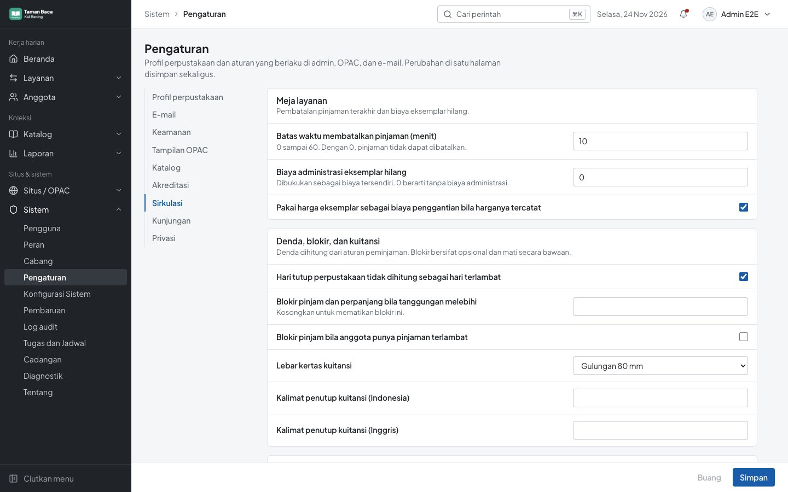

# Sistem

Menu **Sistem** di sidebar, untuk pengelola. Sebagian besar halaman di sini hanya tampil bagi akun yang berizin.

[Kembali ke daftar isi](README.md)

## Pengguna dan peran

**Pengguna** adalah petugas yang masuk ke admin. (Anggota perpustakaan bukan pengguna; mereka dikelola di menu Anggota.)

- **Sistem → Pengguna → Tambah pengguna.** Isi nama pengguna, nama lengkap, e-mail (opsional, dipakai untuk tautan lupa
  kata sandi), dan kata sandi awal. Biarkan "Wajib mengganti kata sandi saat pertama kali masuk" tercentang.
- Beri setiap pengguna **peran**. Tanpa peran, pengguna belum bisa melakukan apa pun. Peran bisa diberikan untuk semua
  cabang atau untuk satu cabang saja.
- **Sistem → Peran:** dua peran bawaan, Super Admin dan Admin, tidak bisa diubah. Buat peran sendiri sesuai pembagian
  kerja, misalnya "Petugas meja" (meja layanan, anggota, kunjungan) dan "Pengatalog" (katalog, label). Centang izinnya
  per modul. Anda hanya bisa memberikan izin yang Anda sendiri miliki.
- Petugas yang berhenti: **nonaktifkan** akunnya, jangan dipakai orang lain. Riwayat kerjanya tetap tercatat.
- Lupa kata sandi: pengguna memakai "Lupa kata sandi" di halaman masuk (bila punya e-mail dan SMTP sudah diatur), atau
  pengelola mengatur ulang dari halaman pengguna itu. Kata sandi sementara ditampilkan sekali dan wajib diganti saat
  masuk berikutnya.

**Verifikasi dua langkah (2FA):** setiap pengguna bisa menyalakannya di **Profil saya** dengan aplikasi autentikator di
ponsel. Simpan **kode cadangan** di tempat aman. 2FA bisa diwajibkan per peran di Pengaturan → Keamanan; sangat
dianjurkan untuk pengelola.

Harus selalu ada paling sedikit satu Super Admin yang aktif.

## Cabang

**Sistem → Cabang.** Perpustakaan dengan satu lokasi cukup memakai cabang yang dibuat saat pemasangan. Tambah cabang
bila ada lokasi layanan lain. Eksemplar, lokasi/rak, meja layanan, kunjungan, dan inventarisasi tercatat per cabang;
katalog judul dan anggota dipakai bersama. Hari tutup di Kalender berlaku untuk semua cabang.

## Pengaturan dan Konfigurasi Sistem

**Sistem → Pengaturan** berisi pengaturan perpustakaan, dikelompokkan di sisi kiri: Profil perpustakaan, E-mail,
Keamanan, Tampilan OPAC, Katalog, Akreditasi, Sirkulasi, Kunjungan, Privasi. Satu bilah **Simpan / Buang** di bawah
berlaku untuk seluruh halaman; ALTIS mengingatkan bila Anda pindah dengan perubahan yang belum disimpan.

**Sistem → Konfigurasi Sistem** berisi hal teknis: alamat situs, server e-mail (SMTP) beserta tombol kirim e-mail uji,
dan token penjadwal. Biasanya diatur sekali bersama orang yang memasang server.

## Cadangan

**Sistem → Cadangan.** Cadangan adalah salinan seluruh data ALTIS.

- **Cadangan harian** dibuat otomatis; halaman ini menunjukkan jadwal berikutnya. **Buat sekarang** membuat cadangan
  kapan saja, misalnya sebelum impor besar. Centang "Sertakan berkas unggahan" supaya sampul, foto, dan lampiran ikut.
- **Simpan salinan di luar server.** Cadangan yang hanya ada di server ikut hilang bila servernya rusak. Pakai **Siapkan
  unduhan**: arsip dienkripsi dengan frasa sandi yang Anda tentukan, lalu diunduh. Catat frasa sandinya di tempat aman;
  tanpa frasa sandi, arsip tidak bisa dipulihkan.
- **Pulihkan:** pilih cadangan lalu ketik nama perpustakaan untuk mengonfirmasi. Seluruh data saat ini diganti dengan
  isi cadangan, dan ALTIS berhenti melayani selama pemulihan. Sebelum mulai, ALTIS membuat cadangan pengaman otomatis.
- **Unggah arsip cadangan** dipakai untuk memulihkan dari arsip yang disimpan di luar, atau saat pindah server.

Biasakan: unduh satu cadangan tiap minggu ke komputer atau diska lain, dan sesekali coba pulihkan di pemasangan uji.

## Pembaruan

**Sistem → Pembaruan** menunjukkan versi yang berjalan dan pembaruan yang tersedia.

1. Buat cadangan dan unduh salinannya.
2. Pilih waktu sepi: selama pembaruan, ALTIS masuk mode pemeliharaan beberapa saat.
3. Tekan **Perbarui ke …** dan ikuti halaman kemajuannya. Paket pembaruan diperiksa tanda tangannya sebelum dipasang.
4. Bila versi baru bermasalah, **Kembali ke versi sebelumnya**. Hanya versi aplikasi yang diganti; data tidak diubah.

Server tanpa internet: unduh paket pembaruan resmi (.zip) di komputer lain, lalu **Unggah paket pembaruan**. Pada
pemasangan Docker, pembaruan dilakukan dengan menarik image baru di server; halaman ini menampilkan perintahnya.

## Diagnostik, tugas, dan log audit

- **Sistem → Diagnostik:** pemeriksaan kesehatan pemasangan, antara lain versi, basis data, ruang penyimpanan, memori,
  jam server, cadangan terakhir, dan uji bahwa folder data tidak terbuka lewat web. Buka halaman ini lebih dulu bila
  ada yang terasa tidak beres, dan sertakan isinya saat meminta bantuan.
- **Kartu "Kesehatan sistem" di Beranda** merangkum cadangan terakhir, pembaruan, antrean tugas, dan penjadwal.
- **Sistem → Tugas dan Jadwal:** pekerjaan latar belakang (impor, ekspor, cadangan, pengingat) dan jadwal hariannya.
  Tugas yang gagal terlihat di sini beserta pesannya.
- **Sistem → Log audit:** catatan setiap tindakan penting, siapa dan kapan. Catatan tidak bisa diubah atau dihapus.
- **Sistem → Tentang:** versi, edisi, lisensi, dan tautan kode sumber.
