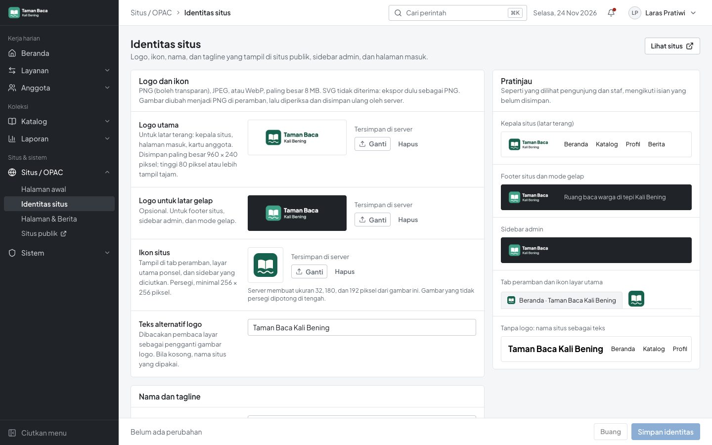
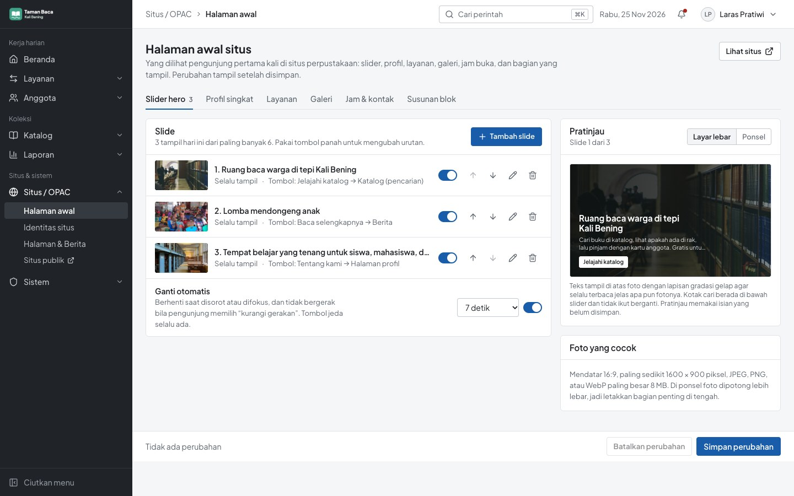

# Situs / OPAC

Situs publik perpustakaan sekaligus katalog daring (OPAC). Pengunjung membukanya di alamat utama ALTIS; halaman admin
ada di `/admin`. Semua pengaturannya ada di menu **Situs / OPAC**.

[Kembali ke daftar isi](README.md)

## Yang dilihat pengunjung

- **Beranda:** slider, kotak cari, profil singkat, layanan, judul baru, judul terpopuler, subjek, berita dan agenda,
  galeri, jam buka dan lokasi.
- **Katalog:** pencarian sederhana dan lanjutan, saringan hasil, halaman judul dengan ketersediaan eksemplar dan letak rak.
- **Profil** (`/profil`), **Galeri** (`/galeri`), **Berita** (`/berita`), dan halaman tetap (`/halaman/...`).
- **Akun anggota** (`/akun`): pinjaman, riwayat, reservasi, penanda, kartu anggota, denda dan biaya, ganti kata sandi,
  unduh data sendiri. Anggota masuk dengan nomor anggota dan kata sandi yang diatur petugas.
- Situs tersedia dalam bahasa Indonesia dan Inggris, mode terang dan gelap (mengikuti pengaturan perangkat atau diubah
  lewat tombol **Gelap** / **Terang** di kepala situs), dan nyaman dibuka di ponsel.

Data pribadi anggota tidak pernah tampil di halaman publik.

## Identitas situs dan logo

**Situs / OPAC → Identitas situs.**

- **Logo utama** (untuk latar terang): tampil di kepala situs, halaman masuk, dan kartu anggota. Bentuk mendatar; tinggi
  80 piksel atau lebih supaya tajam.
- **Logo untuk latar gelap** (opsional): untuk footer, sidebar admin, dan mode gelap. Tanpa ini, logo utama ditaruh di
  atas kotak putih kecil.
- **Ikon:** persegi, minimal 256 × 256 piksel. Tampil di tab peramban dan layar utama ponsel.
- **Nama situs** dan **tagline**. Bila nama dikosongkan, nama perpustakaan dari Pengaturan yang dipakai. Tanpa logo, nama
  tampil sebagai teks.

Tentang berkas logo:

- Berkas yang disimpan selalu **PNG**. Anda boleh memilih JPEG atau WebP; peramban mengubahnya menjadi PNG sebelum
  diunggah.
- **SVG tidak diterima.** Ekspor logo sebagai PNG dari aplikasi desain, lalu unggah PNG itu.
- Berkas sumber paling besar 8 MB. PNG yang disimpan "berjalin" (interlaced) ditolak; simpan ulang tanpa pilihan itu.
- Latar transparan disarankan supaya logo menyatu dengan warna situs.

Bagian pratinjau menunjukkan hasilnya sebelum disimpan. Setelah disimpan, perubahan langsung tampil di situs dan admin.

## Halaman awal

**Situs / OPAC → Halaman awal** punya enam tab dan satu bilah **Simpan** di bawah. Situs baru berubah setelah disimpan.

- **Slider hero:** paling banyak 6 slide. Tiap slide: foto, judul, subjudul, catatan kecil (misalnya tanggal acara),
  tombol dengan tujuannya (berita, halaman, atau alamat di situs ini), dan jadwal tampil (dari tanggal sampai tanggal).
  Urutan diubah dengan tombol panah. Foto mendatar 16:9 tampil penuh sebagai latar slide dengan lapisan gradasi gelap di
  bawah teks agar judul tetap jelas terbaca apa pun fotonya (letakkan bagian penting foto agak ke kanan atau tengah agar
  tidak tertutup teks di layar lebar maupun potongan di ponsel). Slider berganti otomatis, berhenti saat disorot, dan
  selalu punya tombol jeda.
- **Profil singkat:** paragraf tentang perpustakaan dan fotonya; sejarah dan lini masa; visi dan misi; pengelola (nama
  dan jabatan yang sengaja Anda ketik untuk dipublikasikan). Jumlah koleksi dan anggota aktif dihitung otomatis.
- **Layanan:** daftar layanan dan foto fasilitas.
- **Galeri:** paling banyak 8 foto, dipotong 4:3. Tanpa foto, galeri tidak tampil.
- **Jam & kontak:** jam buka seperti yang dibaca pengunjung, telepon, dan e-mail perpustakaan (bukan alamat pribadi).
- **Susunan blok:** matikan bagian beranda yang belum siap, dan pilih **warna perpustakaan**. ALTIS menolak warna yang
  terlalu terang untuk teks putih.

Setiap foto perlu **teks alternatif**: satu kalimat yang menjelaskan isi foto untuk pengunjung yang memakai pembaca
layar.

## Berita, agenda, dan halaman

**Situs / OPAC → Halaman & Berita.**

- **Halaman** untuk isi tetap, misalnya tata tertib atau cara menjadi anggota. Centang "Tampilkan di menu OPAC" untuk
  memasukkannya ke menu situs (paling banyak 8 halaman).
- **Berita** untuk pengumuman dan kegiatan, dengan kategori dan ringkasan. Berita juga tersedia sebagai umpan RSS.
- **Agenda:** bila sebuah berita mengumumkan acara, isi waktu mulai (dan selesai) serta tempatnya. Acara yang belum
  lewat tampil di agenda beranda dan halaman Berita.
- **Jadwal terbit:** kosongkan waktu terbit agar terbit saat disimpan, atau isi waktu yang akan datang.
- **Terjemahan Inggris** opsional. Tanpa terjemahan, pengunjung berbahasa Inggris melihat isi bahasa Indonesia.
- Gambar bisa disisipkan ke isi. Pratinjau menunjukkan isi seperti di situs.

## Pengaturan lain

- **Sistem → Pengaturan → Tampilan OPAC:** teks sambutan dan warna aksen (warna tombol dan tautan).
- **Sistem → Pengaturan → Katalog:** jumlah hasil per halaman, jumlah judul baru di beranda, izin mesin pencari
  mengindeks situs, peta rak di halaman judul, dan panen OAI-PMH untuk katalog induk.
- **Sistem → Pengaturan → Sirkulasi:** apakah anggota boleh memesan (reservasi) dari OPAC.
